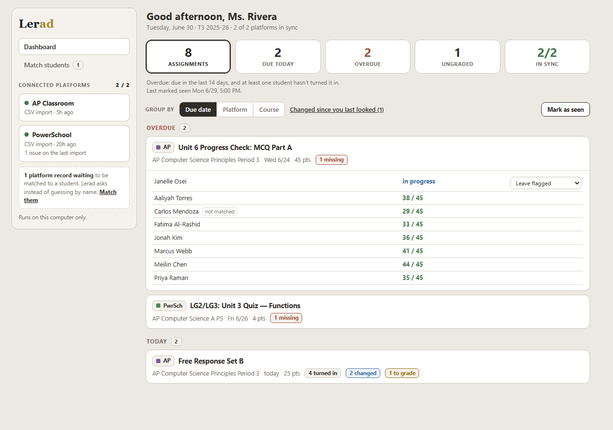

My last post went up on August 15, two weeks before school started. Then school started.

This fall I'm teaching AP Computer Science Principles and an engineering course that's new to me,
which came with its own round of PD training. I'm also in the middle of PhD coursework. Anyone
who teaches knows what that adds up to: the hours that used to go to WorldTree went to lesson
plans, grading, and reading for class. The work didn't stop, but it slowed to whatever fit around a
teaching week, and the blog went quiet.

It also means I owe you a correction. I wrote in August that we'd start piloting
[Lerad](/lerad) in one Brooklyn classroom in September. That didn't happen, and I've added notes to
those posts saying so.

Thanksgiving break is the first stretch since August with whole days in it. So since last Friday,
I've been building.

## What exists now

Lerad is now a working classroom prototype. It runs on one laptop, mine, and nowhere else. It
doesn't connect to the internet, and it refuses to keep its data in any folder that syncs to the
cloud. It reads the exports a teacher can already download from PowerSchool and AP Classroom, and
turns them into one page:

- **Due today, Overdue, and Ungraded**, counted across both platforms. Click a number and the list
  narrows to the assignments behind it, so the count and the list can't disagree.
- **One list**, grouped by due date, platform, or course. Open any assignment to see each student,
  with the ones who still owe work at the top.
- **Students matched by school email, never by name.** One system calls a student "Mei Lin Chen"
  and the other says "Meilin Chen." When a record has no email, Lerad asks me who it is instead
  of guessing.
- **Flags I can resolve without rewriting the record.** If I gave a student an extension, I mark it
  ("extension granted · Mon 11/23, 4:04 PM") and the assignment leaves Overdue. What PowerSchool
  says stays exactly as PowerSchool said it.
- **What changed since I last looked**, so Monday morning starts with the difference, not the whole
  list again.

<figure class="shot">
  
  <figcaption>The prototype on its test class. Every student is fictional, and the date is June 30
  because that's where the test data lives. The open assignment is overdue because one student is
  still in progress; the menu beside that student's name is how I'd resolve it. Carlos Mendoza's record came
  without a school email, so it waits for me to match it.</figcaption>
</figure>

Now the honest status, because the last time I wrote about Lerad I got it wrong. All of this has been
built and tested on fictional students only, with 196 automated tests behind it. Nothing from a real
class touches it until my school authorizes that in writing. Our NY Education Law §2-d privacy pack
is drafted, but education-privacy counsel hasn't reviewed it yet. And Google Classroom, the platform
most teachers would expect first, isn't connected yet. It's next.

## Three ways a dashboard lies

The most useful part of the week wasn't the features. It was finding out how easily a dashboard
produces a number that looks reasonable and is wrong. None of these showed up in the clean test data
I started with. They showed up the moment I checked the counts against how my classes actually work.

**1. It counts students who weren't in the class.** When I checked my roster against the gradebook's
attendance records, students who had joined a section mid-trimester were flagged for work that was
due before they arrived, and students who had left were still being charged for work assigned after
they'd gone. A dashboard that only knows who is enrolled *today* will call that "missing." The fix
was to read each student's entry and exit dates from the roster, so a student owes only the work that
was due while they were in the class. In the test data, a student who joins on June 28 is no longer
flagged for a quiz due June 26.

**2. It guesses what a blank means.** A blank score in a gradebook export can mean two things: the
student never turned it in, or they did and it isn't graded yet. Which one depends on the teacher.
I always set the Missing flag on work that wasn't turned in, so in my gradebook a blank, unflagged
score means "turned in, still to grade," and Lerad counts it as Ungraded. A colleague who leaves
missing work blank would see the same cell land in the wrong pile. There's no setting that's right
for every teacher. The honest move is to ask how a teacher grades before showing them a single count.

**3. It doesn't speak the school's grading scale.** At my school, learning-goal work is scored 0 to 4,
and the end-of-unit Culminating Task gets a letter, A through D. The first version of the importer had
never seen a letter in the score column, read it as an unknown code, and marked the work "not
started." Every graded project in the class turned into missing work, and Overdue jumped. Letters now
count as graded, kept exactly as written, never converted into numbers.

Every one of these produces a clean, confident number. That's what makes them dangerous. In August I
wrote that [districts fall back on cost per user](/blog/cost-per-user-wins-by-default/) because the
better evidence is too expensive to get. This is the other half of that problem: the evidence that
*is* cheap to get, a count on a dashboard, is only as good as its assumptions about the classroom it
came from. If you're evaluating any tool that shows teachers "missing work," these are three questions
worth asking it.

## The obvious objection

A prototype built in my own classroom is not a pilot, and I agree. The second problem above is the
proof: my gradebook habits are baked into how the prototype reads a blank cell, and a colleague's
aren't. That's exactly why the next step is other teachers, not more features.

There's a second objection I'd raise if I were reading this. A teacher building software on their own
school's data is the kind of thing a privacy-minded district should worry about. That's why nothing
real goes in until the school says yes in writing, why the data never leaves the laptop, and why the
privacy paperwork came before the code.

## What's next

The Google Classroom
connector. Counsel's review of the §2-d pack. And other teachers, because a dashboard that only
understands one teacher's gradebook isn't a product yet.

It's a prototype one teacher built over a holiday week. But it already refuses to show a number it
can't explain, which was the whole point.

If you'd like to try it with your own classes when it's ready, [join the waitlist](/lerad#waitlist).
